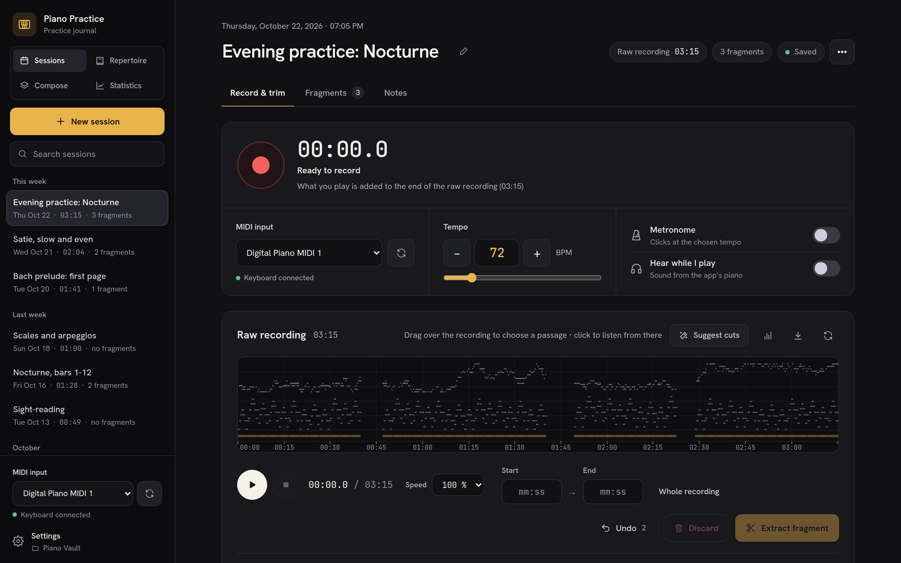
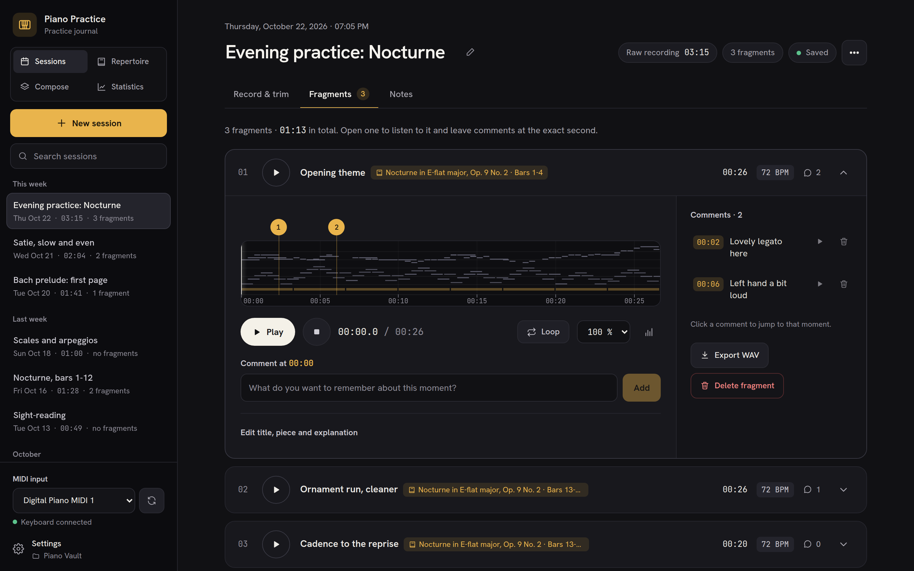
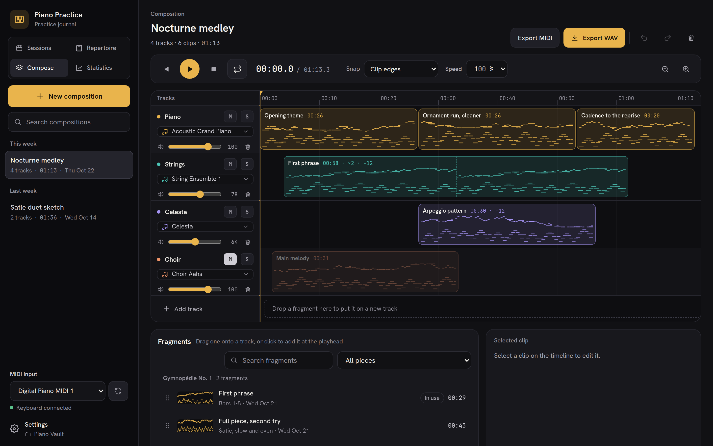
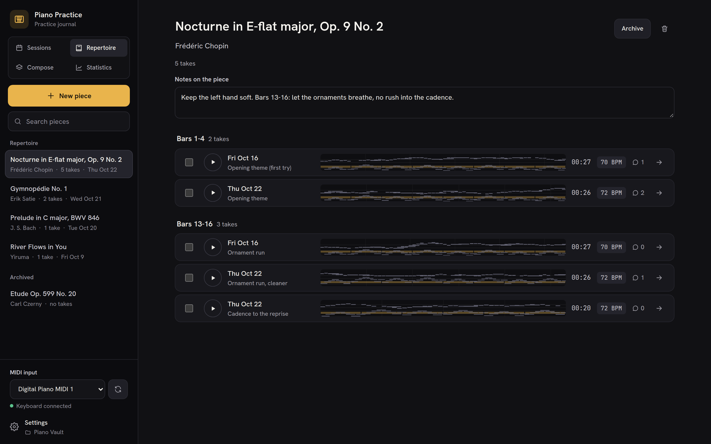
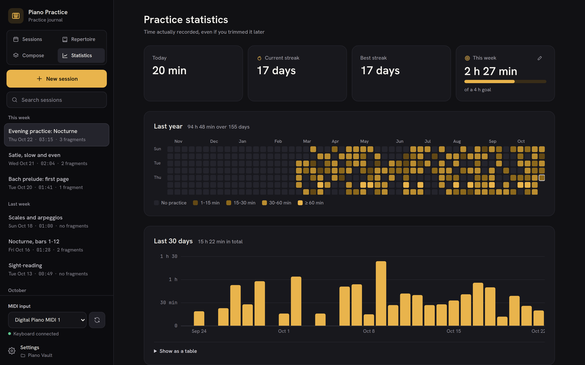

<div align="center">


# Piano Practice Tracker

**Record your piano practice over USB-MIDI, slice it into fragments, compare takes and arrange them into compositions.**

[](https://github.com/KeoH/piano-practice-tracker/actions/workflows/release.yml)
[](https://github.com/KeoH/piano-practice-tracker/releases/latest)
[](LICENSE)

<br />
[](https://tauri.app)
[](https://angular.dev)
[](https://www.rust-lang.org)

[Download](https://github.com/KeoH/piano-practice-tracker/releases/latest) · [Features](#features) · [Installation](#installation) · [Development](#development)



</div>

A desktop app for Linux and macOS, built with **Tauri v2** (Rust) and **Angular 22**. It works fully offline, and all your data lives in a folder you choose.

## Features

### Record and trim
- **Record over USB-MIDI** from any MIDI port, with a built-in metronome and optional live monitoring through the synthesizer (off by default, so you hear your own digital piano with no latency). Recording again in a session appends the new take to the end of the existing one.
- **Slice the raw take** on a piano roll (or note-density bars). Select a range to extract it as a standalone **fragment**, or discard it (silences, mistakes). Either way the range is removed from the raw take and the gap is closed. Open notes and the sustain pedal are handled at the cut points.
- **Suggested cuts** split the take into passages separated by silence, and every trim can be **undone**.

### Listen and annotate
- **Playback** through a SoundFont synthesizer (`rustysynth`), with seek, an **A-B loop** and **slower speeds** that keep the pitch.
- **Timeline comments** anchored to an exact moment of a fragment, and **Markdown notes** per session, with images you can paste or drop in.
- **Export** any take or fragment as WAV.

### Repertoire
- File fragments under a **piece** and a **passage** (for example "Bars 13-16"), and see every take of a passage in chronological order to hear your progress.
- **Compare two takes** on the same time scale.

### Composer
- Arrange fragments on up to 15 **tracks**, each with its own General MIDI instrument, volume, mute and solo.
- Trim, split, repeat and transpose **clips**, with undo and redo.
- Export the result as **WAV** or as a **multitrack MIDI** file.

### Statistics
- Time practised today and this week against a **weekly goal**, current and best **streaks**, a **year heatmap** and the last 30 days.

### Your data, your folder
- **Vaults:** all your data lives in a folder you choose, Obsidian-style. The app syncs nothing itself: put the vault in Dropbox, Syncthing or similar and that service copies it. A lock warns you before you open a vault that is already in use on another computer.
- **English and Spanish.** The app follows the system language and can be switched in Settings.
- **Simulator port** that generates notes, for trying the app without a keyboard.

## Screenshots

<table>
  <tr>
    <td width="50%"></td>
    <td width="50%"></td>
  </tr>
  <tr>
    <td align="center"><b>Fragments</b> with comments at the exact second</td>
    <td align="center"><b>Composer</b> with General MIDI tracks</td>
  </tr>
  <tr>
    <td width="50%"></td>
    <td width="50%"></td>
  </tr>
  <tr>
    <td align="center"><b>Repertoire</b>: takes grouped by passage</td>
    <td align="center"><b>Statistics</b>: streaks, goal and heatmap</td>
  </tr>
</table>

## Installation

Download the latest `.deb` or `.AppImage` from [Releases](https://github.com/KeoH/piano-practice-tracker/releases). Each release includes a `SHA256SUMS.txt`:

```bash
sha256sum -c SHA256SUMS.txt --ignore-missing
```

Install the `.deb`:

```bash
sudo apt install ./Piano*Practice*Tracker*_amd64.deb
```

You can also open the `.deb` with Ubuntu's App Center. It shows a "Potentially unsafe" warning because the package doesn't come from the store; that is expected for any downloaded `.deb`, so check it against `SHA256SUMS.txt` first.

Or run the AppImage directly:

```bash
chmod +x Piano*Practice*Tracker*.AppImage
./Piano*Practice*Tracker*.AppImage
```

### Better piano sound

The app picks a SoundFont in this order:

1. the one you choose in **Settings** (only `.sf2`; `.sf3` is not supported);
2. a General MIDI SoundFont installed on the system, such as FluidR3;
3. a synthetic piano generated by the app as a last resort, which doesn't sound very realistic.

To get a decent sound out of the box, install FluidR3:

```bash
sudo apt install fluid-soundfont-gm
```

## Getting started

1. On first launch, **create a vault** in a new or empty folder, or **open** an existing one.
2. Create a **session**, pick your MIDI port and BPM, and record in the *Record & trim* tab.
3. Select ranges on the timeline to extract fragments or discard parts of the take.
4. Play fragments back and add comments in the *Fragments* tab; write notes in the *Notes* tab.

### Where your data lives

| Location | Contents |
| --- | --- |
| `<vault>/piano_tracker.sqlite` | Sessions, fragments, comments and notes |
| `<vault>/midi/raw/`, `<vault>/midi/fragments/` | MIDI files (SMF format 0) |
| `<vault>/media/` | Images in the notes |
| `<vault>/.piano-tracker/` | Vault marker and lock |
| `~/.config/piano-tracker/config.json` | Per-machine settings: current and recent vaults, SoundFont, language |

Paths inside the database are relative to the vault, so you can move it or sync it between computers. Avoid having the same vault open on two computers at once: the sync service would end up creating conflicting copies of the database.

## Development

### Requirements

- Ubuntu 22.04 or later
- [Rust](https://rustup.rs/) (stable)
- Node.js 22 and npm
- System packages:

  ```bash
  sudo apt install build-essential curl wget file patchelf pkg-config \
    libwebkit2gtk-4.1-dev libxdo-dev libssl-dev \
    libayatana-appindicator3-dev librsvg2-dev libasound2-dev
  ```

### Commands

```bash
npm install
npm run tauri dev       # run the full app (Angular dev server on :4200 + Rust backend)
npm run tauri build     # build the .deb and .AppImage packages
npm run build           # build the frontend only

npm test                # frontend tests (Vitest, watch mode)
npm run test:ci         # frontend tests once, with coverage in coverage/piano-tracker/

cd src-tauri
cargo test --lib                     # backend tests
cargo llvm-cov --lib --summary-only  # backend coverage (needs `cargo install cargo-llvm-cov`)
```

Running `npm start` in a regular browser works for UI work, but calls to the backend fail gracefully because Tauri isn't there.

### Screenshots

The images in this README are generated from the dev server with invented demo data, so they can be refreshed after a UI change. With `npm start` running, in another terminal:

```bash
node scripts/screenshots/capture.mjs   # writes docs/screenshots/*.png (needs Google Chrome)
```

`scripts/screenshots/demo-ipc.js` stands in for the Tauri backend and holds the demo vault; `CHROME=/path/to/chromium` picks another browser.

### Project layout

```
src/                 Angular frontend (standalone, zoneless, signals, Tailwind v4)
  app/core/          stores, IPC service (TauriApiService), i18n
  app/components/    UI components (timeline, slicer, player, editor…)
  locales/           translations shared by frontend and backend
src-tauri/src/       Rust backend
  commands.rs        Tauri commands (the IPC surface)
  midi_recorder.rs   MIDI capture (midir)
  midi_slicer.rs     activity analysis, extraction and trimming (midly)
  audio_engine.rs    synthesizer, sequencer and metronome (cpal + rustysynth)
  vault.rs, db.rs    vaults, locking and SQLite storage
```

More detail:

- [`SPECIFICATIONS.md`](SPECIFICATIONS.md): functional and technical specification.
- [`TASKS.md`](TASKS.md): implementation plan.
- [`CLAUDE.md`](CLAUDE.md): architecture notes and conventions for contributors.

### Translations

English (`src/locales/en.json`) is the reference and Spanish is a translation. To add a language, copy `en.json` to `src/locales/<code>.json`, translate it, and register it in `src/app/core/i18n/languages.ts` and `src-tauri/src/i18n.rs`. `cargo test` fails if a translation is missing keys or placeholders.

## Contributing

Pull requests run the CI (frontend build and tests, backend tests and coverage). PR titles follow [Conventional Commits](https://www.conventionalcommits.org/) (`feat:`, `fix:`, `feat!:`…), because they become the commit on `main` after the squash merge. [release-please](https://github.com/googleapis/release-please) uses them to work out the next version, update `CHANGELOG.md` and publish the release packages. Don't edit version numbers by hand.

## License

[MIT](LICENSE) © 2026 Francisco Manzano
